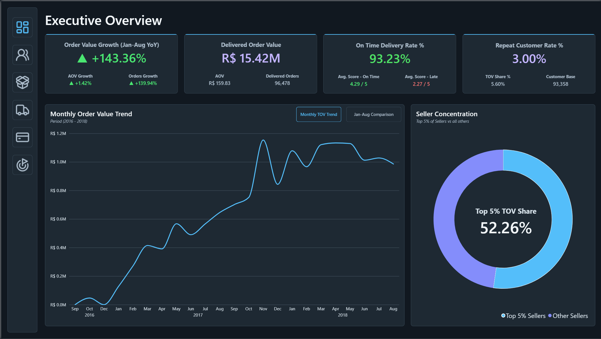
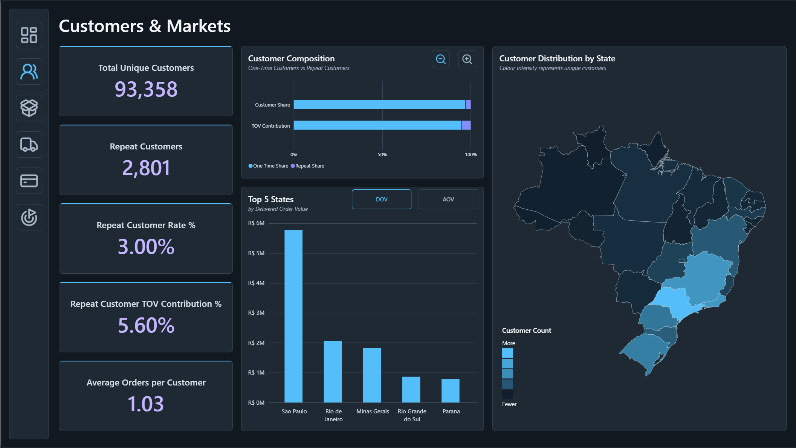
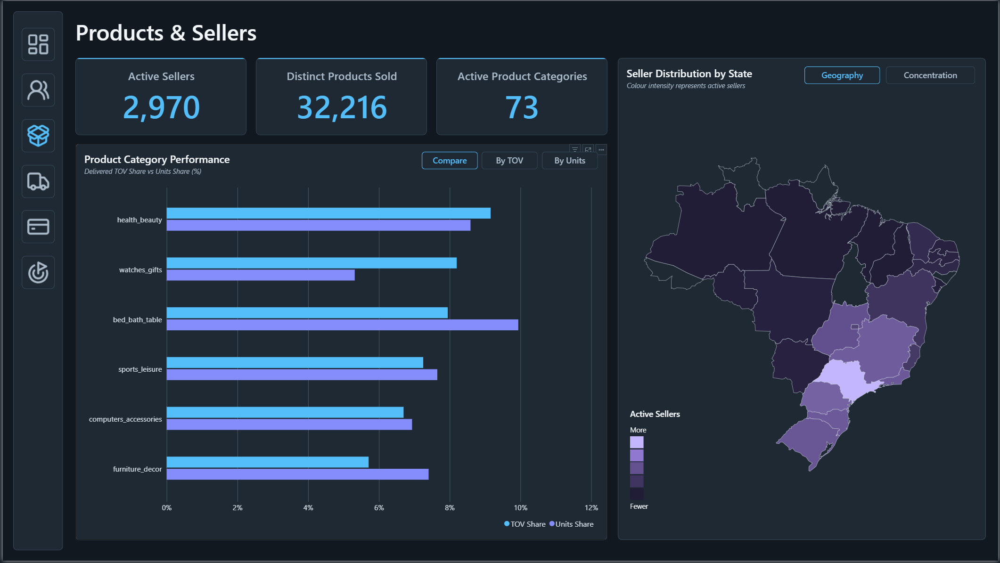
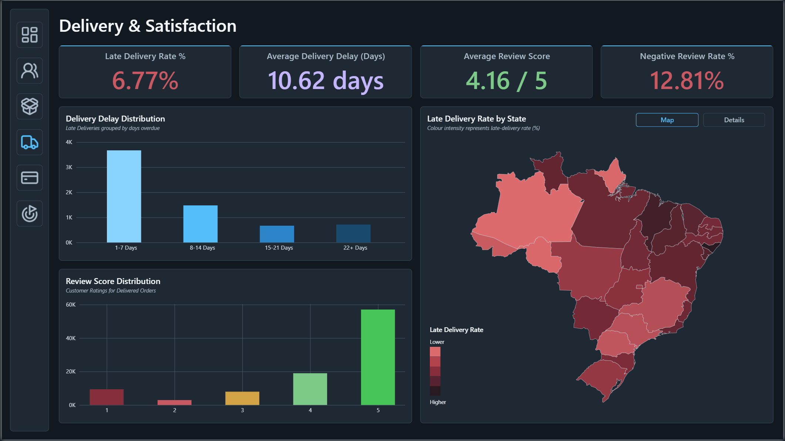
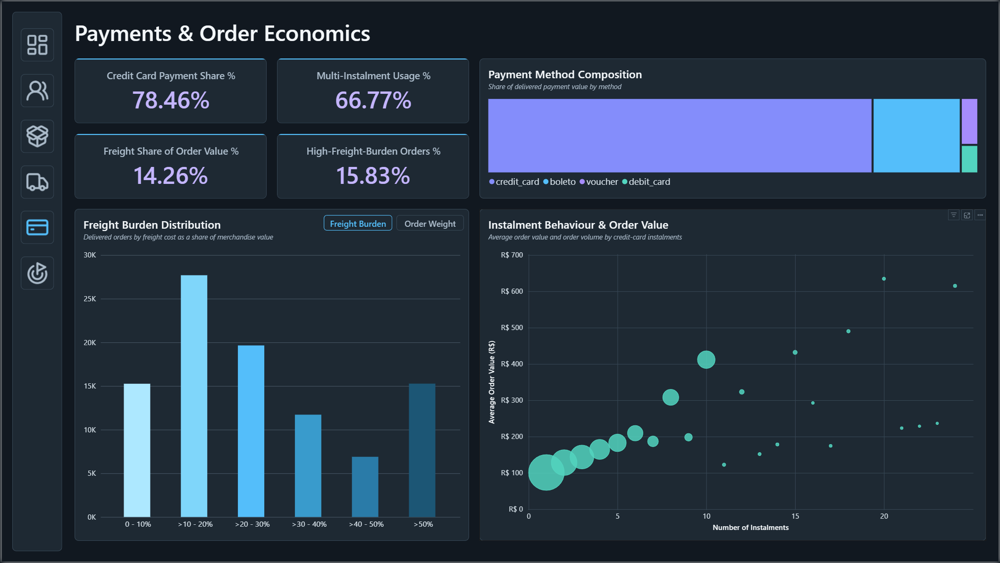
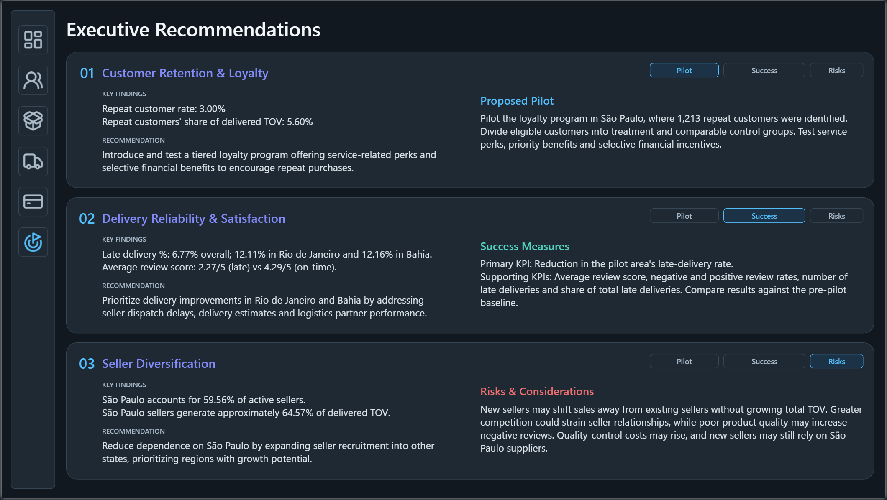

# Olist E-Commerce Analytics

**An end-to-end data analytics project using Excel, PostgreSQL, SQL and Power BI.**

I used the Brazilian E-Commerce Public Dataset by Olist to explore how the marketplace performed between 2016 and 2018. My focus was on understanding sales growth, customer behaviour, product and seller performance, delivery reliability, customer reviews and payment patterns.

The project covers the process from exploring and validating the original data to building a six-page Power BI report and developing three business recommendations.

**Tools:** Excel · PostgreSQL · SQL · Power BI · DAX  
**Dataset:** [Brazilian E-Commerce Public Dataset by Olist (Kaggle)](https://www.kaggle.com/datasets/olistbr/brazilian-ecommerce)

### Download the Interactive Power BI Report

[**Download the full Power BI report (.pbix)**](https://github.com/TaimoorAtif/olist-ecommerce-analytics/releases/latest)

The report can be opened in Power BI Desktop for Windows. It contains the saved data model, DAX measures, and six interactive dashboard pages.
---

## Power BI Dashboard

The final report contains six pages, with bookmark-controlled views for exploring different parts of the analysis.

| Executive Overview | Customers & Markets |
|:---:|:---:|
|  |  |
| **Products & Sellers** | **Delivery & Satisfaction** |
|  |  |
| **Payments & Order Economics** | **Executive Recommendations** |
|  |  |

**Alternative dashboard views:**

- [Executive Overview — Jan–Aug Comparison](screenshots/alternates/executive_overview_alt.png)
- [Customers & Markets — Alternative Charts](screenshots/alternates/customer_markets_alt.png)
- [Products & Sellers — Seller Concentration](screenshots/alternates/products_sellers_alt.png)
- [Delivery & Satisfaction — Regional Details](screenshots/alternates/delivery_satisfaction_alt.png)
- [Payments & Order Economics — Freight by Order Weight](screenshots/alternates/payments_orders_alt.png)

*These are static screenshots of the finished Power BI report. The original report includes interactive navigation, filters, tooltips and bookmark controls.*

---

## Key Findings

| Metric | Result |
|---|---:|
| Delivered orders | **96,478** |
| Delivered Total Order Value (TOV) | **R$15.42M** |
| TOV growth, Jan–Aug 2018 vs 2017 | **+143.36%** |
| Repeat customer rate | **3.00%** |
| Delivered TOV from the top 5% of sellers | **52.26%** |
| Late delivery rate | **6.77%** |
| Average review score | **4.16 / 5** |

A few findings stood out during the analysis:

- **Sales growth:** Delivered order value increased by 143.36% when comparing January–August 2018 with the same period in 2017. I used matching periods because the dataset does not contain a complete 2018 trading year.
- **Customer retention:** Only 3% of customers placed more than one delivered order during the observed period. These repeat customers contributed 5.60% of delivered TOV.
- **Seller concentration:** The top 5% of active sellers generated 52.26% of delivered TOV. São Paulo alone accounted for 59.56% of active sellers.
- **Delivery and satisfaction:** 6.77% of evaluable delivered orders arrived late. Late deliveries had an average review score of 2.27/5, compared with 4.29/5 for on-time deliveries. This shows a strong association, not proof that delays caused the lower ratings.
- **Payments and freight:** Credit cards accounted for 78.46% of delivered payment value. Freight represented 14.26% of delivered order value, making shipping costs another area worth investigating.

## How I Worked Through the Data

The dataset contains nine related CSV files covering orders, customers, products, sellers, payments, reviews and geographic information.

I worked through the project in stages:

1. **Exploration and validation:** Started in Excel, then used PostgreSQL to check missing values, duplicates, key uniqueness, table relationships and unusual records.
2. **Staging and cleaning:** Created staging tables with appropriate data types, primary keys, foreign keys and validation constraints. Kept the raw data separate.
3. **Data modelling:** Built fact and dimension tables for Power BI. I paid particular attention to different table grains, composite keys, repeat-customer identification and avoiding duplicated values during joins.
4. **SQL analysis:** Investigated commercial performance, customer activity, seller concentration, delivery, reviews, payments and freight costs. Used the findings to decide what belonged in the report.
5. **Power BI reporting:** Built DAX measures, created the six report pages, added bookmark-based views and checked the results against SQL where applicable.

One important modelling decision involved the geolocation data: ZIP prefixes had multiple records, so I created a ZIP-level staging table instead of joining the original geolocation table directly and risking duplicated customer or seller records.

## Business Recommendations

Based on the findings, I developed three recommendations:

| Area | Proposed action |
|---|---|
| **Customer retention** | Test a loyalty programme in São Paulo, using comparable customer groups to measure whether the benefits lead to additional repeat purchases. |
| **Delivery reliability** | Investigate seller dispatch, delivery estimates and logistics performance, initially focusing on Rio de Janeiro and Bahia. |
| **Seller diversification** | Explore recruiting more reliable sellers outside São Paulo to reduce geographic concentration and support business continuity. |

The recommendations include proposed pilots, measures of success and risks. **They are suggestions based on historical analysis, not initiatives that were implemented or tested.**

More detail is available in the [Excel project documentation](documentation/Olist%20-%20Project%20Documentation.xlsx) and the Executive Recommendations dashboard page.

---

## Project Files

| Folder / File | Contents |
|---|---|
| [Selected SQL Queries](sql/olist-selected-queries.sql) | A shorter selection of validation, transformation, modelling and analytical SQL |
| [Original SQL Working Script](sql/olist-working-script.sql) | My complete working SQL file, including exploratory queries and development steps |
| [Excel Draft Board](documentation/Olist%20-%20Project%20Documentation.xlsx) | Exploration, validation, staging, modelling, analysis, recommendations and Power BI development notes |
| [Dashboard Screenshots](screenshots/) | All six report pages and five alternative views |
| [Power BI Report (.pbix)](https://github.com/TaimoorAtif/olist-ecommerce-analytics/releases/latest) | Downloadable six-page interactive report with the saved data model and DAX measures |

The original SQL working script was developed incrementally and is not intended to run from start to finish as an automated database setup. The selected queries use the populated PostgreSQL schemas created during the project.

## Notes & Limitations

- The dataset covers historical transactions from **2016–2018**, not Olist's current business performance.
- Most commercial KPIs focus on delivered orders. Some review, delivery and payment calculations have additional eligibility rules.
- Repeat purchasing is measured within the available dataset period, not across a customer's complete lifetime.
- Total Order Value includes merchandise value and freight; it should not be interpreted as company profit.
- The recommendations identify areas worth testing. Their actual business impact is unknown.

## Data Source

[Brazilian E-Commerce Public Dataset by Olist — Kaggle](https://www.kaggle.com/datasets/olistbr/brazilian-ecommerce)

This is an independent portfolio project using a publicly available, anonymized dataset. It is not an official analysis commissioned by Olist.

---

**Taimoor Atif**  
*Data Analytics Portfolio — Project 01*
